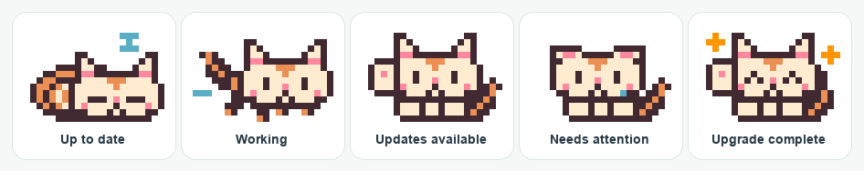
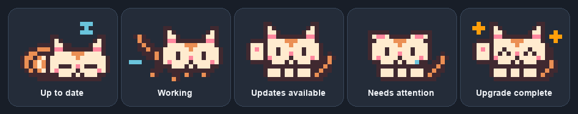

# PortCat 🐾

A tiny menu bar cat that looks after your MacPorts, and tells you when other tools on your Mac (Codex, Homebrew, npm, App Store apps) have updates too. Part of [brew2port](../README.md).



The cat's pose tells you how your ports are doing at a glance:

| Cat | Meaning |
|---|---|
| Curled up, zzz | Everything is up to date |
| Running | Checking, syncing or upgrading |
| Sitting, waving, with a number | That many ports are outdated |
| Ears down | MacPorts is missing or something needs a look |
| Jumping with sparkles | An upgrade just finished |

Click the cat to see what's outdated and upgrade one port or all of them (the MacPorts `codex` port is skipped: it only supports Apple Silicon, so Codex is updated with its official installer instead), list what you've installed, run `port diagnose`, clean up old versions (`port reclaim`), and turn on Open at Login.

It also helps you get off Homebrew:

| Button | What it does |
|---|---|
| **Install MacPorts** | Downloads the official `.pkg` for your macOS, checks its SHA256 and Apple signature, then installs it |
| **Move them…** | Runs brew2port in Terminal to install MacPorts versions of your Homebrew formulae (shows the plan and asks first) |
| **Remove old copies…** | Removes each Homebrew formula once its MacPorts version is installed, then clears unneeded dependencies |
| **Keep in Homebrew** | For tools with no MacPorts port (e.g. `supabase`): stop reminding me. **Undo** brings them back |
| **Clean up Homebrew** | Appears when Homebrew has leftover dependencies nothing uses; runs `brew autoremove` and `brew cleanup` (no password) |
| **Update** (Codex) | Appears when a newer Codex CLI is out. Runs the official installer (`curl -fsSL https://chatgpt.com/codex/install.sh \| sh`): in the background if Codex came from that installer, otherwise in Terminal so it can replace a Homebrew/npm copy |
| **Update** (Other apps) | Lists outdated Homebrew formulae and apps, npm global packages and App Store apps (needs [`mas`](https://github.com/mas-cli/mas)). Homebrew apps update in Terminal because their installers can ask for a password; the rest update in the background. **Update all** does everything in one go |
| **Clean up** | The MacPorts side: `port reclaim` removes old versions, unused downloads and unneeded dependencies |

The gear menu at the bottom lets you choose which sources the cat checks (for example, turn off npm) and pause notifications for a day or a week.

Homebrew itself is never uninstalled, since it can't be reinstalled on Intel Macs.

It checks for outdated ports (and a newer Codex, if you have it) on its own every 3 hours and whenever you open it. When something new turns up it sends a macOS notification with an **Update now** / **Upgrade all** button, once per new version. macOS asks the first time whether PortCat may send notifications; you can change that later in System Settings → Notifications. Those checks don't need a password. Anything that changes your system (syncing the package list, upgrading, cleaning up) shows the standard macOS password dialog each time, and nothing runs as root in the background.

## Build and install

Needs macOS 13 or later and Xcode or the Command Line Tools (`xcode-select --install`).

```bash
cd PortCat
./build-app.sh --install     # builds PortCat.app and copies it to /Applications
```

`./build-app.sh` alone builds to `build/PortCat.app` without installing. `--universal` builds for Intel and Apple Silicon (needs full Xcode).

If `swift build` fails with `Invalid manifest` / `PackageDescription` errors, your Command Line Tools install is probably damaged. The script then compiles with `swiftc` directly and carries on, so you usually don't need to do anything. You can force that path with `PORTCAT_USE_SWIFTC=1 ./build-app.sh`. If both fail, reinstall the tools: `sudo rm -rf /Library/Developer/CommandLineTools && xcode-select --install`.

The app icon is the sitting cat from the menu bar. `Icon/make-icon.py` draws it (needs `pip install pillow`) and writes `Icon/PortCat.icns`; run it again if you change the cat's art or colors. If the Dock or Finder keeps showing an old icon after you reinstall, run `killall Dock Finder` to clear the icon cache.

The app is ad-hoc signed, not notarized. Because you build it yourself it opens normally; if you share a pre-built copy, others will need to right-click → Open the first time.

## Notes

- The cat follows light and dark mode automatically, in the menu bar and in the popover:

  

- The cat is original pixel art drawn for this project; the frames live in `Sources/PortCat/CatFrames.swift` as text grids, so they're easy to tweak.
- “Check for updates” runs `port selfupdate`, which needs the password. Until you've done that once, the outdated list is based on your local package index.
- Log output of every command is under **Log** in the popover.

If the cat makes your day a little nicer, you can [buy me a coffee ☕](https://buymeacoffee.com/bypazs).

MIT License.
