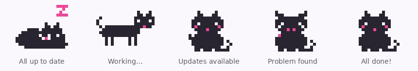

# PortCat 🐾

A tiny menu bar cat that looks after your MacPorts. Part of [brew2port](../README.md).



The cat's pose tells you how your ports are doing at a glance:

| Cat | Meaning |
|---|---|
| Curled up, zzz | Everything is up to date |
| Running | Checking, syncing or upgrading |
| Sitting, waving, with a number | That many ports are outdated |
| Ears down | MacPorts is missing or something needs a look |
| Jumping with sparkles | An upgrade just finished |

Click the cat to see what's outdated and upgrade one port or all of them, list what you've installed, run `port diagnose`, clean up old versions (`port reclaim`), and turn on Open at Login.

It also helps you get off Homebrew:

| Button | What it does |
|---|---|
| **Install MacPorts** | Downloads the official `.pkg` for your macOS, checks its SHA256 and Apple signature, then installs it |
| **Move them…** | Runs brew2port in Terminal to install MacPorts versions of your Homebrew formulae (shows the plan and asks first) |
| **Remove old copies…** | Removes each Homebrew formula once its MacPorts version is installed, then clears unneeded dependencies |
| **Keep in Homebrew** | For tools with no MacPorts port (e.g. `supabase`): stop reminding me. **Undo** brings them back |
| **Clean up Homebrew** | Appears when Homebrew has leftover dependencies nothing uses; runs `brew autoremove` and `brew cleanup` (no password) |
| **Clean up** | The MacPorts side: `port reclaim` removes old versions, unused downloads and unneeded dependencies |

Homebrew itself is never uninstalled, since it can't be reinstalled on Intel Macs.

It checks for outdated ports on its own every 3 hours and whenever you open it. Those checks don't need a password. Anything that changes your system (syncing the package list, upgrading, cleaning up) shows the standard macOS password dialog each time, and nothing runs as root in the background.

## Build and install

Needs macOS 13 or later and Xcode or the Command Line Tools (`xcode-select --install`).

```bash
cd PortCat
./build-app.sh --install     # builds PortCat.app and copies it to /Applications
```

`./build-app.sh` alone builds to `build/PortCat.app` without installing. `--universal` builds for Intel and Apple Silicon (needs full Xcode).

The app is ad-hoc signed, not notarized. Because you build it yourself it opens normally; if you share a pre-built copy, others will need to right-click → Open the first time.

## Notes

- The cat follows light and dark mode automatically, in the menu bar and in the popover:

  

- The cat is original pixel art drawn for this project; the frames live in `Sources/PortCat/CatFrames.swift` as text grids, so they're easy to tweak.
- “Check for updates” runs `port selfupdate`, which needs the password. Until you've done that once, the outdated list is based on your local package index.
- Log output of every command is under **Log** in the popover.

If the cat makes your day a little nicer, you can [buy me a coffee ☕](https://buymeacoffee.com/bypazs).

MIT License.
